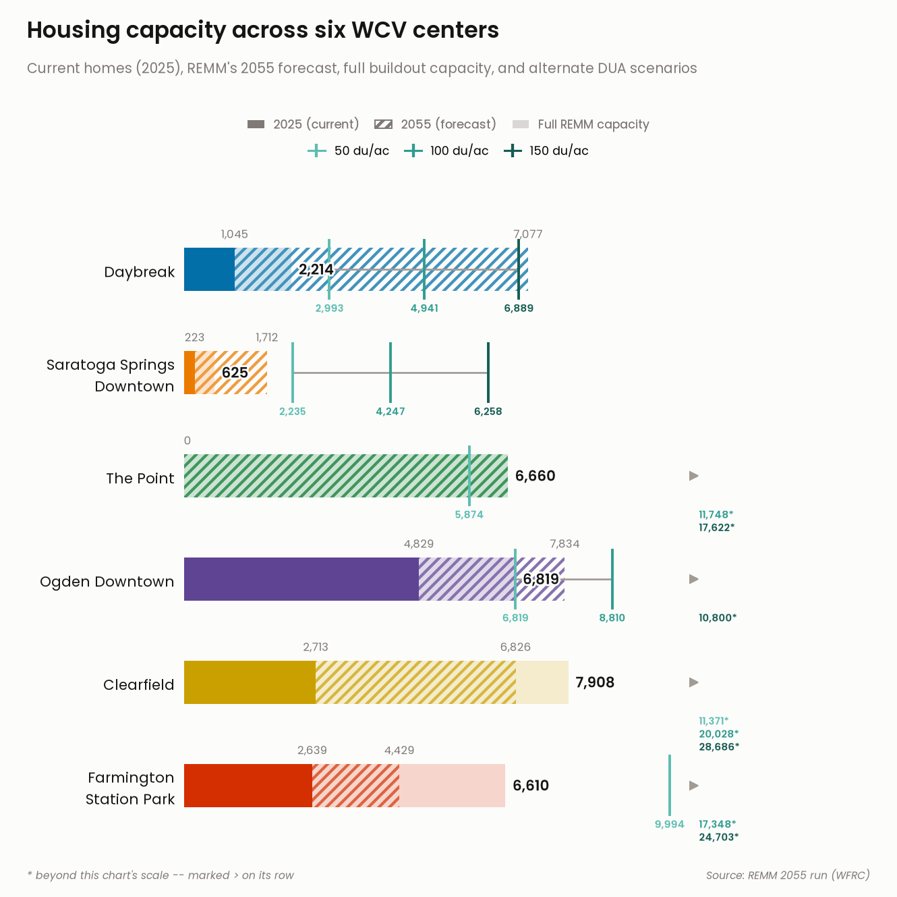
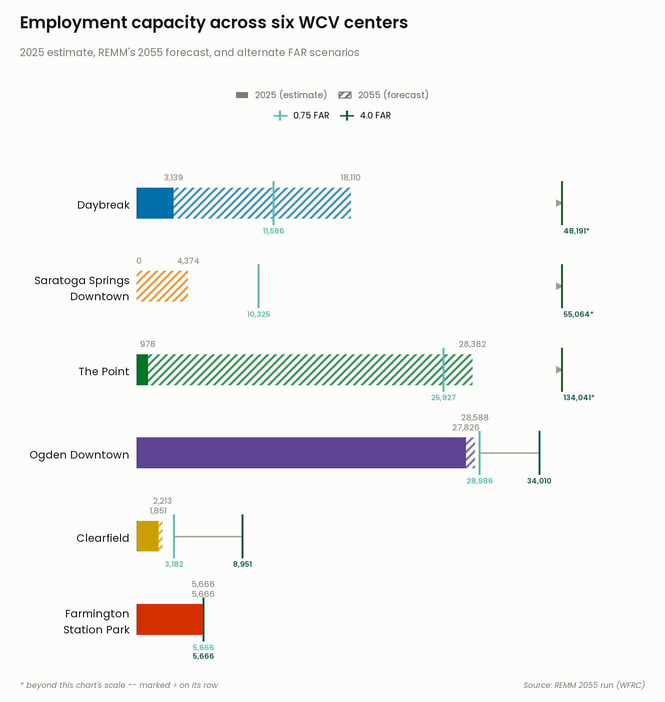
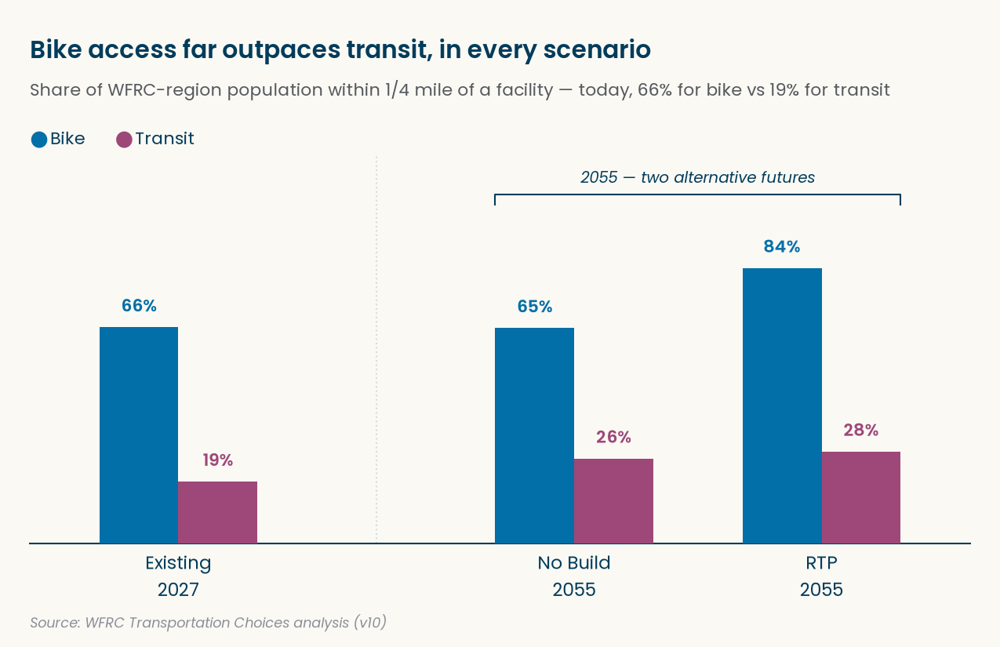
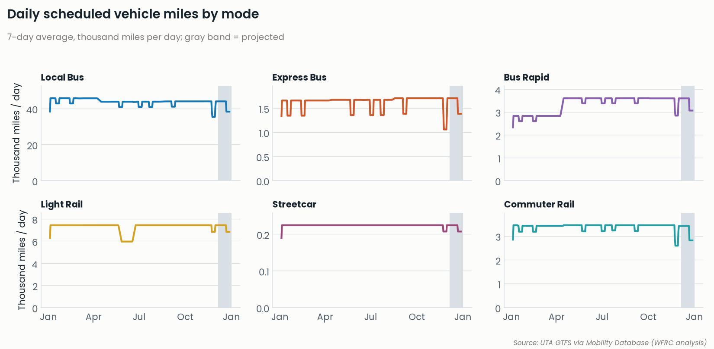

A working index of ad hoc geospatial analyses for WFRC. Each analysis lives in its own folder under `projects/`, with its own data sources, script/notebook, and outputs. See `README.md` and `CLAUDE.md` at the repo root for conventions.

To start a new analysis, copy `projects/_template/` (its underscore prefix keeps it -- and any other in-progress scaffold folder -- out of this published site by convention).

## [Center Buildout Capacity](projects/center-buildout-capacity/index.qmd)

REMM's 2025 estimate, its 2055 forecast, and full buildout capacity for six Wasatch Choice Vision centers: Daybreak, Saratoga Springs Downtown, The Point, Ogden Downtown, Clearfield, and Farmington Station Park.

::: {layout-ncol="2"}
{.lightbox group="center-buildout-capacity"}

{.lightbox group="center-buildout-capacity"}
:::

## [Transportation Choices](projects/transportation-choices/index.qmd)

Percent of the WFRC-region population within 1/4 mile of a dedicated bike facility, or a frequent bus route / transit stop / station, across seven scenarios: Existing 2027, plus No Build and RTP (Build) in each of 2036, 2046, and 2055.

{.lightbox group="transportation-choices"}

## [UTA Transit VMT 2026](projects/uta-transit-vmt-2026/index.qmd)

Scheduled annual transit vehicle miles of travel for UTA in 2026 -- about 21.8 million revenue miles -- split by Local Bus, Express Bus, Bus Rapid, Light Rail, and Commuter Rail (plus Ski Bus), built trip by trip from the GTFS schedules in effect on each day of the year.

{.lightbox group="uta-transit-vmt-2026"}
