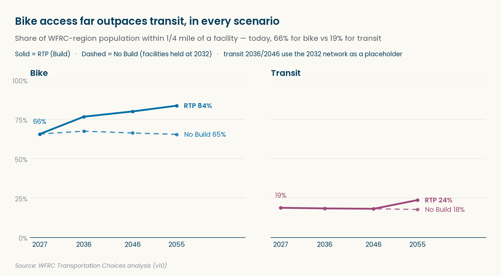

## Purpose

How much of the Wasatch Front's population lives somewhere they can actually *choose* to bike or take transit instead of drive? Transportation Choices answers that with one number per place: the percent of people within 1/4 mile of a dedicated bike facility, or of a frequent bus route, transit stop, or station.

That number only means something next to a point of comparison, so we compute it for seven scenarios: today, plus two alternate futures -- No Build and RTP (Build) -- at each of the RTP's phase years, 2036, 2046, and 2055. Each scenario is a combination of two independent inputs that do **not** have to match: a socioeconomic (SE) forecast year, and a GIS facility *vintage* year (what's actually built on the ground, or assumed built, as of some year) -- set separately per mode, since bike and transit vintages don't line up year for year.

| Scenario | SE year | Bike GIS vintage | Transit GIS vintage | Reads as |
|---------------|---------------|---------------|---------------|---------------|
| Existing 2027 | 2027 | 2027 | 2027 | today |
| No Build 2036 / 2046 / 2055 | 2036 / 2046 / 2055 | 2032 | 2032 | that year's population, with only STIP-programmed projects built |
| RTP (Build) 2036 | 2036 | 2036 | 2032 *(placeholder)* | 2036's population, with RTP phase 1 built |
| RTP (Build) 2046 | 2046 | 2046 | 2032 *(placeholder)* | 2046's population, with RTP phases 1-2 built |
| RTP (Build) 2055 | 2055 | 2055 | 2055 | 2055's population, with every funded RTP phase built |

Comparing No Build against RTP in the same year isolates the effect of *building the plan* -- same future population, different infrastructure. Following No Build across years shows how much of the change is just growth.

::: callout-important
## How the future vintages are defined

**Bike** future vintages come from the RTP 2027 Preferred Scenario project layers, each one adding the projects expected between it and the vintage before:

-   **2032** = the 2027 base plus RTP projects flagged `Field9_STIP = 1` -- projects already programmed in the STIP, built 2027-2032.
-   **2036** = 2032 plus `phase = 1` projects, built 2032-2036.
-   **2046** = 2036 plus `phase = 2` projects, built 2036-2046.
-   **2055** = 2046 plus `phase = 3` projects, built 2046-2055.

`phase = 0` projects are unfunded (needed but not financially constrained) and never added. Because bike vintages are cumulative, a STIP project stays in every later vintage whatever its `phase` (currently one STIP AT line has `phase = 0`).

**Transit** future vintages come from the WF TDM's own 2032 and 2055 transit networks (the `WFv1000_MasterNet_20260903` GDB from Suzie): the high-frequency stops each modeled network actually serves. Each is a complete network, not a set of additions, so transit 2032 and 2055 stand alone rather than building on 2027. There's no TDM stop data for 2036 or 2046 yet, so RTP 2036 and 2046 use the 2032 transit network as a placeholder -- until real stop data replaces it, transit for RTP and No Build is identical in those two years.
:::

GIS facility data is *incremental* by vintage year and mode: each vintage either layers new facilities on top of an earlier one, or (like the TDM transit networks) restates the whole network itself. That's what makes the pipeline easy to extend -- adding a scenario is one line in `SCENARIOS`, and adding a GIS vintage is one entry in `GIS_VINTAGES`.

This replaces the `_archive/` v9 arcpy scripts (01-08), which bundled SE and facility data together per scenario (so SE year and GIS vintage couldn't vary independently) and filtered transit stops with a hardcoded route list.

## Data Sources

| Mode | Vintage | What's added | Source |
|------------------|------------------|------------------|------------------|
| Bike | 2027 (base) | On-street bike facilities + trails | `utah_bikeways`, filtered to `Facility1` excluding "Not Available" and the class-3 shared-roadway/shoulder family |
| Bike | 2032 | RTP 2027 Preferred Scenario AT line projects in the STIP (`Field9_STIP = 1`) | `at_line_projects` |
| Bike | 2036 | RTP AT line projects in `phase` 1 (excluding STIP, already in 2032) | `at_line_projects` |
| Bike | 2046 | RTP AT line projects in `phase` 2 (excluding STIP) | `at_line_projects` |
| Bike | 2055 | RTP AT line projects in `phase` 3 (excluding STIP) | `at_line_projects` |
| Transit | 2027 (base) | Fixed-guideway stations + frequent bus stops | `uta_stops` + `uta_routes` |
| Transit | 2032 | Full TDM 2032 network: rail/BRT stops + frequent (≤15 min) local/core bus stops | `_data/raw/WFv1000_MasterNet_20260903.gdb` (`*_2032_PTNode`/`PTLine`) |
| Transit | 2055 | Full TDM 2055 network, same filter | `_data/raw/WFv1000_MasterNet_20260903.gdb` (`*_2055_PTNode`/`PTLine`) |
| Transit | 2036, 2046 | *(placeholder)* no vintage of its own yet -- scenarios reuse transit 2032 until TDM stop data for these years arrives | -- |

Socioeconomic data is WFRC's v10 forecast, one CSV per year (2023-2065) under `_data/raw/SE_v10_20260921/`. TAZ geometry comes from the `WasatchFrontTAZ` REST service (`wftcm_taz`).

## Setup

Two structures carry all of the above as data rather than as logic: `GIS_VINTAGES` encodes what each vintage adds and which earlier vintage it builds on, and `SCENARIOS` points each named scenario at an SE year plus a GIS vintage per mode, and places it on a `path` (Existing, No Build, or RTP) at a `year` for the charts. Nothing downstream needs to change to add a scenario or a vintage -- only these two structures do.

```{python}
#| label: setup

from pathlib import Path
import pandas as pd
import geopandas as gpd
from gis_adhoc_analyses.layer_cache import ensure_layers

PATHS = {
    "se_dir": Path("_data/raw/SE_v10_20260921"),
    "tdm_gdb": Path("_data/raw/WFv1000_MasterNet_20260903.gdb"),
    "output": Path("output"),
}

CRS = "EPSG:26912"  # UTM 12N, meters -- project everything to this before buffering/intersecting

CONSTANTS = {
    "buffer_m": 0.25 * 1609.34,  # 0.25 mi in meters
    "wfrc_county_fips": [3, 11, 35, 57],  # Box Elder, Davis, Salt Lake, Weber
    "se_join_field": "TAZID",
}

# Incremental by vintage year: "adds" are layer keys new at that vintage,
# "builds_on" is the vintage it layers on top of (None = base vintage).
GIS_VINTAGES = {
    "bike": {
        2027: {"adds": ["utah_bikeways"], "builds_on": None},
        2032: {"adds": ["at_line_projects"], "builds_on": 2027},  # STIP projects
        2036: {"adds": ["at_line_projects"], "builds_on": 2032},  # phase 1, non-STIP
        2046: {"adds": ["at_line_projects"], "builds_on": 2036},  # phase 2, non-STIP
        2055: {"adds": ["at_line_projects"], "builds_on": 2046},  # phase 3, non-STIP
    },
    "transit": {
        2027: {"adds": ["uta_stops", "uta_routes"], "builds_on": None},
        # Full TDM networks from PATHS["tdm_gdb"] (not REST) -- standalone, not cumulative
        2032: {"adds": [], "builds_on": None},
        2055: {"adds": [], "builds_on": None},
    },
}

# gis_year is per mode: bike and transit vintages don't line up year for year.
# No Build holds GIS at 2032 while SE moves on. RTP transit 2036/2046 reuse 2032
# as a placeholder until TDM stop data for those years arrives.
SCENARIOS = [
    {"name": "existing_2027", "path": "Existing", "year": 2027, "se_year": 2027, "gis_year": {"bike": 2027, "transit": 2027}},
    {"name": "no_build_2036", "path": "No Build", "year": 2036, "se_year": 2036, "gis_year": {"bike": 2032, "transit": 2032}},
    {"name": "no_build_2046", "path": "No Build", "year": 2046, "se_year": 2046, "gis_year": {"bike": 2032, "transit": 2032}},
    {"name": "no_build_2055", "path": "No Build", "year": 2055, "se_year": 2055, "gis_year": {"bike": 2032, "transit": 2032}},
    {"name": "rtp_2036", "path": "RTP", "year": 2036, "se_year": 2036, "gis_year": {"bike": 2036, "transit": 2032}},
    {"name": "rtp_2046", "path": "RTP", "year": 2046, "se_year": 2046, "gis_year": {"bike": 2046, "transit": 2032}},
    {"name": "rtp_2055", "path": "RTP", "year": 2055, "se_year": 2055, "gis_year": {"bike": 2055, "transit": 2055}},
]
for scenario in SCENARIOS:
    for mode, gis_year in scenario["gis_year"].items():
        assert gis_year in GIS_VINTAGES[mode], f"{scenario['name']}: no {mode} vintage {gis_year}"
```

## Data Acquisition

Every REST layer any vintage needs gets fetched once, up front, by reading the keys straight out of `GIS_VINTAGES` -- add a layer to a vintage and it's automatically requested here too.

```{python}
#| label: fetch-rest-layers

rest_keys = sorted(
    {"wftcm_taz"}
    | {layer for mode in GIS_VINTAGES.values() for v in mode.values() for layer in v["adds"]}
)
L = ensure_layers(rest_keys)
print(f"Fetched {len(L)} REST layers: {rest_keys}")
```

```{python}
#| label: check-se-years

se_years_available = sorted(
    int(p.stem.removeprefix("SE_")) for p in PATHS["se_dir"].glob("SE_*.csv")
)
assert se_years_available, f"No SE files found under {PATHS['se_dir']}"
for scenario in SCENARIOS:
    assert scenario["se_year"] in se_years_available, (
        f"Scenario {scenario['name']!r} needs SE_{scenario['se_year']}.csv -- not found"
    )
print(
    f"SE years available: {se_years_available[0]}-{se_years_available[-1]} ({len(se_years_available)} files)"
)
print("All scenario SE years present.")
```

::: callout-note
## Geography levels beyond region and county

The v9 pipeline summarized results by workshop area as well as region and county. The `wftcm_taz` layer's `CITYGRP` field reproduces that same workshop-area breakdown (its values -- "Northern Salt Lake County," "Southwest Salt Lake County," "Southern Weber County," etc. -- line up with the v9 script's `SmallArea` boundary names), so it's used here as `WorkshopArea`. The layer's WFTDM district fields (`DISTLRG`/`DISTMED`/`DISTSML`) add three more levels of their own -- `CityName`, `DistrictLarge`, `DistrictMedium`, and `DistrictSmall` -- all without needing a separate boundary source. (`DISTSUPER`/`DSUP_NAME` also exists on the layer, but within the WFRC footprint it's identical to `CountyName`, so it isn't added as its own level.)
:::

## Build Facility Geometry — Bike {#sec-bike-geometry}

Bike facilities are line geometry, buffered directly: `utah_bikeways`'s `Facility1` field distinguishes facility type, encoded with AGRC's 1/2/3 bikeway class suffixes (1 = physically separated cycle track, 2 = bike lane, 3 = shared roadway/shoulder). `"Not Available"` means no bike facility at all, but the class-3 family (`"Other bike route, unspecified (3)"`, `"Shoulder bikeway (3A)"`, `"Marked shared roadway (3B)"`, `"Signed shared roadway (3C)"`) is excluded too -- it's just a stripe or sign on a road shared with traffic, not a dedicated facility, and the v9 `_archive/` script excluded the same codes (`bike_l`/`bike_r NOT IN ('3','3A','3B','3C')`). Everything else -- bike lanes, buffered/protected cycle tracks, and trails -- is existing network. The 2032 vintage adds the STIP-programmed subset of the RTP 2027 Preferred Scenario's active-transportation **line** projects (`Field9_STIP = 1`), and 2036, 2046, and 2055 add the rest one funding phase at a time (`phase` 1, 2, 3; `phase = 0` is unfunded and never added) -- every row in `at_line_projects` is already a bike path facility type (shared-use path, trail, bike lane, sidepath, etc.), matching `utah_bikeways`'s own facility categories. The companion point layer (`at_point_projects`) is pedestrian/bike crossings, not bike-path segments, so it's excluded here -- `WFRCAnalytics/GIS-RTP-Phasing-Criteria` treats those crossings as a separate network-connectivity attribute rather than part of the facility network.

```{python}
#| label: bike-raw-by-vintage

# Excludes "Not Available" (no facility) and the class-3 shared-roadway/shoulder
# family -- not a dedicated facility, matching the v9 _archive/ script's
# bike_l/bike_r NOT IN ('3','3A','3B','3C') exclusion.
_BIKE_EXCLUDED_FACILITY1_SQL = (
    "'Not Available','Other bike route, unspecified (3)','Shoulder bikeway (3A)',"
    "'Marked shared roadway (3B)','Signed shared roadway (3C)'"
)

# RTP project funding filters: STIP-programmed by 2032, then one phase per
# vintage (phase 0 = unfunded, never added). STIP projects aren't repeated in
# later phases' adds -- the cumulative build already carries them forward.
_RTP_SQL = {
    2032: "Field9_STIP = 1",
    2036: "phase = '1' AND Field9_STIP <> 1",
    2046: "phase = '2' AND Field9_STIP <> 1",
    2055: "phase = '3' AND Field9_STIP <> 1",
}

bike_raw = {
    2027: gpd.read_file(
        L["utah_bikeways"],
        where=f"Facility1 IS NOT NULL AND Facility1 NOT IN ({_BIKE_EXCLUDED_FACILITY1_SQL})",
    ).to_crs(CRS)[["geometry"]],
    **{
        year: gpd.read_file(L["at_line_projects"], where=sql).to_crs(CRS)[["geometry"]]
        for year, sql in _RTP_SQL.items()
    },
}
for year, gdf in bike_raw.items():
    print(f"Bike {year} adds: {len(gdf)} features")
```

Each vintage's cumulative network is its own `adds` plus everything the vintage it `builds_on` already had -- so 2055 includes the 2032 STIP projects and phases 1-2 without listing them again, and a vintage with nothing new would simply be identical to the vintage beneath it, not empty. Buffering and dissolving that cumulative network once per vintage gives the geometry every scenario needing that vintage can reuse.

```{python}
#| label: bike-buffers-by-vintage

bike_cum = {}
for year in sorted(GIS_VINTAGES["bike"]):
    builds_on = GIS_VINTAGES["bike"][year]["builds_on"]
    parts = [bike_raw[year]] if builds_on is None else [bike_cum[builds_on], bike_raw[year]]
    bike_cum[year] = gpd.GeoDataFrame(
        pd.concat(parts, ignore_index=True), geometry="geometry", crs=CRS
    )

bike_buffers = {
    year: gpd.GeoDataFrame(geometry=[cum.buffer(CONSTANTS["buffer_m"]).union_all()], crs=CRS)
    for year, cum in bike_cum.items()
}
for year, cum in bike_cum.items():
    print(f"Bike {year} cumulative: {len(cum)} features")
```

## Build Facility Geometry — Transit {#sec-transit-geometry}

Transit works differently in a way that matters for the buffer, not just the source. The 2027 base is built entirely from **stop/station points**, and only from a *subset* of stops --

1.  LRT/CRT fixed-guideway stations, caught by `mode` containing `TRAX` or `FrontRunner`, and
2.  **frequent bus stops only** -- `uta_routes` filtered to the frequent/fixed-guideway service tiers, matched back to stops through the comma-separated `route` field.

Every other bus stop is excluded -- `Regular`, `Limited` (peak-only commuter), `Ski`, and flex/microtransit service -- leaving roughly 1,400 of UTA's ~5,500 stops. This two-part filter is the same one `WFRCAnalytics/GIS-RTP-Phasing-Criteria` uses for existing high-frequency stops (`active-transportation/09_transit-connectivity.qmd`), and replaces v9's hardcoded route list with something that updates itself as UTA's service changes. UTA's `Frequent` tier is 15-minute service, which is also the threshold the 2032/2055 TDM vintages below use.

```{python}
#| label: transit-2027-base

_HF_ROUTETYPES_SQL = "'Frequent','BRT','Blue Line','Red Line','Green Line','S Line','FrontRunner'"
hf_route_abbrs = set(
    gpd.read_file(L["uta_routes"], where=f"routetype IN ({_HF_ROUTETYPES_SQL})")["lineabbr"].astype(
        str
    )
)

stops_raw = gpd.read_file(L["uta_stops"]).to_crs(CRS)
fixed_guideway = stops_raw[stops_raw["mode"].str.contains("TRAX|FrontRunner|BRT", na=False)]
hf_routes = stops_raw[
    stops_raw["route"].apply(
        lambda r: (
            False if pd.isna(r) else bool({t.strip() for t in str(r).split(",")} & hf_route_abbrs)
        )
    )
]
transit_2027 = gpd.GeoDataFrame(
    pd.concat(
        [fixed_guideway[["geometry"]], hf_routes[["geometry"]]], ignore_index=True
    ).drop_duplicates(),
    geometry="geometry",
    crs=CRS,
)
print(f"Fixed-guideway / BRT stops: {len(fixed_guideway)}")
print(f"Frequent-route stops:      {len(hf_routes)}")
print(f"Transit 2027 base (dedup): {len(transit_2027)}")
```

The 2032 and 2055 vintages come from the WF TDM's transit networks instead (`WFv1000_MasterNet_20260903.gdb`, exported from Cube by Suzie). The GDB holds one Cube transit *group* per `.lin` file per year (`rail_2032`, `wfrc_brt_2055`, `wfrc_sl_lcl_2032`, ...), each split into three layers: `_PTLine` (one row per route, with `MODE` and `HEADWAY_1`), `_PTNode` (every node each route passes through, in sequence), and `_PTLink`. Only the first two are needed: a `_PTNode` row with `STOPNODE = 1` is a stop (the rest are pass-through shape nodes), and its `LINEID` is the 1-based row position of its route in the matching `_PTLine` layer. The highway network layers in the same GDB aren't used.

Each year's groups are a complete modeled network -- 2032's `rail` group already includes today's TRAX and FrontRunner lines, and routes get restructured between years (some frequent 2032 stops aren't in 2055 at all) -- so these vintages replace the 2027 base rather than layering on top of it. The same two-part filter as 2027 applies, using TDM mode codes:

1.  **fixed guideway / BRT** -- `MODE` 7 (LRT/streetcar), 8 (commuter rail), 9 (BRT), at any headway, and
2.  **frequent bus** -- `MODE` 4 (local) or 5 (core) routes with an AM peak headway (`HEADWAY_1`) of 15 minutes or better, UTA's own "Frequent" threshold.

Express bus (`MODE` 6) is excluded, like every other bus stop that doesn't make the frequency cut. A stop served by several qualifying routes is counted once (deduplicated on TDM node number `NODES`).

```{python}
#| label: transit-raw-by-vintage

# WF TDM transit modes: 4 local bus, 5 core bus, 6 express bus,
# 7 LRT/streetcar, 8 commuter rail, 9 BRT
_TDM_FIXED_GUIDEWAY_MODES = [7, 8, 9]
_TDM_FREQUENT_BUS_MODES = [4, 5]
_TDM_FREQUENT_HEADWAY_MIN = 15


def read_tdm_stops(year):
    """High-frequency stop nodes across every TDM transit group for one network year."""
    groups = gpd.read_file(PATHS["tdm_gdb"], layer="CITILABS_TRANSITGROUPS", ignore_geometry=True)
    parts = []
    for group in groups.loc[groups["TRANSITGROUP_NAME"].str.endswith(f"_{year}"), "TRANSITGROUP_NAME"]:
        lines = gpd.read_file(
            PATHS["tdm_gdb"], layer=f"{group}_PTLine", ignore_geometry=True, columns=["NAME", "MODE", "HEADWAY_1"]
        )
        lines["LINEID"] = range(1, len(lines) + 1)  # LINEID = row position in _PTLine
        nodes = gpd.read_file(PATHS["tdm_gdb"], layer=f"{group}_PTNode", columns=["LINEID", "STOPNODE", "NODES"])
        assert nodes["LINEID"].isin(lines["LINEID"]).all(), f"{group}: LINEID outside _PTLine rows"
        parts.append(nodes[nodes["STOPNODE"] == 1].merge(lines, on="LINEID", validate="many_to_one"))
    assert parts, f"No TDM transit groups found for {year}"

    stops = gpd.GeoDataFrame(pd.concat(parts, ignore_index=True), geometry="geometry", crs=parts[0].crs)
    frequent = stops[
        stops["MODE"].isin(_TDM_FIXED_GUIDEWAY_MODES)
        | (
            stops["MODE"].isin(_TDM_FREQUENT_BUS_MODES)
            & stops["HEADWAY_1"].between(0, _TDM_FREQUENT_HEADWAY_MIN, inclusive="right")
        )
    ]
    print(f"Transit {year} TDM frequent stops by mode: {frequent.groupby('MODE')['NODES'].nunique().to_dict()}")
    return frequent.drop_duplicates("NODES").to_crs(CRS)[["geometry"]].reset_index(drop=True)


transit_raw = {
    2027: transit_2027,
    2032: read_tdm_stops(2032),
    2055: read_tdm_stops(2055),
}
for year, gdf in transit_raw.items():
    print(f"Transit {year} adds: {len(gdf)} features")
```

```{python}
#| label: transit-buffers-by-vintage

transit_cum = {}
for year in sorted(GIS_VINTAGES["transit"]):
    builds_on = GIS_VINTAGES["transit"][year]["builds_on"]
    parts = (
        [transit_raw[year]] if builds_on is None else [transit_cum[builds_on], transit_raw[year]]
    )
    transit_cum[year] = gpd.GeoDataFrame(
        pd.concat(parts, ignore_index=True), geometry="geometry", crs=CRS
    )

transit_buffers = {
    year: gpd.GeoDataFrame(geometry=[cum.buffer(CONSTANTS["buffer_m"]).union_all()], crs=CRS)
    for year, cum in transit_cum.items()
}
for year, cum in transit_cum.items():
    print(f"Transit {year} cumulative: {len(cum)} features")
```

## Prepare TAZ Geography

TAZ geometry itself doesn't change across scenarios -- only the population joined onto it does (that happens in @sec-compute, per scenario). So this runs once: filter to the four WFRC counties, and add the fields every downstream calculation needs -- `Region` (a constant, for the region-level rollup), the geography breakdowns (`CountyName`, `WorkshopArea`, `CityName`, and the WFTDM district hierarchy), and each TAZ's total area in acres. These all come straight off fields already on the TAZ layer (`CITYGRP`, `DISTLRG`/`DISTMED`/`DISTSML`), so there's no separate boundary source to fetch or maintain.

```{python}
#| label: prepare-taz

taz_raw = gpd.read_file(L["wftcm_taz"]).to_crs(CRS)
print(f"TAZ columns: {list(taz_raw.columns)}")

taz = taz_raw[taz_raw["CO_FIPS"].isin(CONSTANTS["wfrc_county_fips"])].copy()
taz["Region"] = "WFRC"
taz["CountyName"] = taz["CO_NAME"].str.title()
taz["WorkshopArea"] = taz["CITYGRP"].replace("", pd.NA)  # blank = not assigned to a workshop area
taz["CityName"] = taz["CITY_NAME"]
taz["DistrictLarge"] = taz["DLRG_NAME"]
taz["DistrictMedium"] = taz["DMED_NAME"]
taz["DistrictSmall"] = taz["DSML_NAME"]
taz["AcresTotal"] = taz.geometry.area / 4046.8564224
print(f"TAZ after county filter: {len(taz)} (from {len(taz_raw)})")
for col in ["CountyName", "WorkshopArea", "CityName", "DistrictLarge", "DistrictMedium", "DistrictSmall"]:
    print(f"  {col}: {taz[col].nunique()} unique, {taz[col].isna().sum()} null")
```

## Compute Compatible-Area % by Scenario {#sec-compute}

We don't know how population is distributed *within* a TAZ, only its total -- so where a facility buffer only partly covers a TAZ, we assume population spreads evenly across the TAZ's area and credit that TAZ with the same share of its population: `HHPOPPiece = HHPOP * (piece area / total area)`. Summing `HHPOPPiece` over all pieces and dividing by total `HHPOP` for a geography gives the percent of its population within 1/4 mile of a facility -- which is exactly `SCENARIOS × modes × geography levels` worth of one number each, so the result is a single tidy table rather than a separate narrow CSV per scenario and geography level, like the old per-scenario scripts produced.

```{python}
#| label: compute-tidy-results

GEOGRAPHY_LEVELS = [
    "Region",
    "CountyName",
    "WorkshopArea",
    "CityName",
    "DistrictLarge",
    "DistrictMedium",
    "DistrictSmall",
]

results = []
for scenario in SCENARIOS:
    se_path = PATHS["se_dir"] / f"SE_{scenario['se_year']}.csv"
    assert se_path.is_file(), f"Missing SE file: {se_path}"
    se = pd.read_csv(se_path)
    se.columns = se.columns.str.lstrip(";")  # v10 export has a stray leading ';' on the header row

    taz_se = taz.merge(
        se[[CONSTANTS["se_join_field"], "HHPOP"]], on=CONSTANTS["se_join_field"], how="left"
    )

    for mode, buffers in (("bike", bike_buffers), ("transit", transit_buffers)):
        pieces = gpd.overlay(taz_se, buffers[scenario["gis_year"][mode]], how="intersection")
        pieces["AcresPiece"] = pieces.geometry.area / 4046.8564224
        pieces["HHPOPPiece"] = pieces["HHPOP"] * pieces["AcresPiece"] / pieces["AcresTotal"]

        for level in GEOGRAPHY_LEVELS:
            totals = taz_se.groupby(level)["HHPOP"].sum()
            piece_totals = (
                pieces.groupby(level)["HHPOPPiece"].sum().reindex(totals.index, fill_value=0)
            )
            # Overlay geometry area can round-trip a hair above the true total
            # (e.g. 1.0000000000000004) due to floating-point noise in the
            # intersection -- clip rather than let it fail the sanity check below.
            pct = (piece_totals / totals).clip(upper=1.0)
            for geography_name, value in pct.items():
                results.append(
                    {
                        "scenario": scenario["name"],
                        "path": scenario["path"],
                        "year": scenario["year"],
                        "mode": mode,
                        "se_year": scenario["se_year"],
                        "gis_year": scenario["gis_year"][mode],
                        "geography_level": level,
                        "geography_name": geography_name,
                        "pct_near_facility": value,
                    }
                )

tidy = pd.DataFrame(results)
print(f"Tidy results: {len(tidy)} rows")

# A handful of fine-grained geographies (e.g. Great Salt Lake open-water districts)
# have zero households, so their share-of-population is undefined (0/0 = NaN) --
# that's a legitimate result, not a bug, so it's excluded from the range check below.
n_undefined = tidy["pct_near_facility"].isna().sum()
if n_undefined:
    zero_pop_geos = sorted(
        tidy.loc[tidy["pct_near_facility"].isna(), "geography_name"].unique()
    )
    print(f"NOTE: {n_undefined} rows have undefined pct (zero-population geography): {zero_pop_geos}")

assert tidy["pct_near_facility"].dropna().between(0, 1).all(), (
    "Percentage outside [0, 1] -- check overlay/weighting"
)
tidy.head()
```

## Outputs

One CSV per scenario, each long-format across modes and geography levels -- easier for a planner to open and filter than many narrow files, and named so each scenario's file is unambiguous on its own. A combined file across all seven scenarios is also saved for the interactive charts below to read directly.

```{python}
#| label: write-outputs

PATHS["output"].mkdir(parents=True, exist_ok=True)
for scenario in SCENARIOS:
    out_path = PATHS["output"] / f"transportation_choices_{scenario['name']}.csv"
    tidy[tidy["scenario"] == scenario["name"]].to_csv(out_path, index=False)
    print(f"Saved -> {out_path}")

tidy_out_path = PATHS["output"] / "transportation_choices_tidy.csv"
tidy.to_csv(tidy_out_path, index=False)
print(f"Saved -> {tidy_out_path}")
```

## Visualization

No Build and RTP are **alternate futures** -- both branch from the same Existing 2027 baseline, so each chart draws two lines per geography forking from that shared starting point and running through 2036, 2046, and 2055: dashed for No Build, solid for RTP. For transit the two lines sit on top of each other through 2046, since both use the 2032 network until real 2036/2046 stop data arrives. Pick a geography level below (region, county, workshop area, city, or large/medium/small WFTDM district), then which geographies at that level to plot and which of the two futures to show -- Bike and Transit live in separate tabs underneath, both driven by the same controls. The gray line is always the WFRC region, so any geography reads directly against the regional reference rather than in isolation. Hover any point for its exact value.

```{ojs}
//| label: load-tidy-data
//| echo: false

// Read client-side via FileAttachment rather than ojs_define() -- the
// combination of ojs_define's embedded <script type="ojs-define"> data with
// this page's panel-tabset layout left tc_data undefined at runtime for
// every dependent cell. WFRCAnalytics/TDM-VAL-SchoolCollegeEnrollment uses
// FileAttachment for all of its interactive pages, including ones with the
// same panel-tabset/panel-input layout, so this follows that precedent
// instead of re-diagnosing the ojs_define interaction further.
tc_data = FileAttachment("output/transportation_choices_tidy.csv").csv({typed: true})
```

```{ojs}
//| label: ojs-setup
//| echo: false

// Existing 2027 is the single shared baseline; No Build and RTP are two
// ALTERNATE futures branching from it -- so the x-axis is real years, and
// each entity gets one line per path, both starting at the same 2027 point
// and styled by path (dashed = No Build, solid = RTP).
PATH_STYLE = ({
  "No Build": {dash: "5,4", label: "No Build"},
  "RTP": {dash: null, label: "RTP (Build)"},
})
YEARS = [...new Set(tc_data.map((d) => d.year))].sort()
LAST_YEAR = YEARS[YEARS.length - 1]
SCENARIO_OPTIONS = Object.keys(PATH_STYLE)

REGION_COLOR = "#7f7a76" // brand wfrc-gray -- dashed/solid reference lines, deliberately neutral
INK = "#023c5b" // brand wfrc-blue

// Brand colors (_extensions/.../brand.yml) validated for CVD-safe separation
// (scripts/validate_palette.js from the dataviz skill) cover a handful of
// entities cleanly; d3's Tableau10 extends the palette for geography levels
// with more selections (e.g. large districts) without hand-picking more
// brand colors.
BRAND_PALETTE = ["#3762ad", "#c98b3a", "#a3423c", "#799f4c"]
function colorPalette(n) {
  const base = [...BRAND_PALETTE, ...d3.schemeTableau10]
  return Array.from({length: n}, (_, i) => base[i % base.length])
}

// Reshape tidy rows into {entity, path, year, value}: one line per entity per
// path, each starting from that entity's Existing 2027 value and then running
// through the path's own scenario years in order.
function branchRows(modeKey, geoLevel, namesFilter) {
  const rows = tc_data.filter(
    (d) => d.mode === modeKey && d.geography_level === geoLevel && (!namesFilter || namesFilter.includes(d.geography_name))
  )
  const byEntity = d3.group(rows, (d) => d.geography_name)
  const out = []
  for (const path of Object.keys(PATH_STYLE)) {
    for (const [entity, entityRows] of byEntity) {
      const start = entityRows.find((d) => d.path === "Existing")
      if (start === undefined) continue
      const future = entityRows.filter((d) => d.path === path).sort((a, b) => a.year - b.year)
      for (const d of [start, ...future]) out.push({entity, path, year: d.year, value: d.pct_near_facility})
    }
  }
  return out
}
```

```{ojs}
//| label: geo-level-source
//| echo: false

GEO_LEVELS = ["Region", "CountyName", "WorkshopArea", "CityName", "DistrictLarge", "DistrictMedium", "DistrictSmall"]
GEO_LEVEL_LABELS = ({
  Region: "Region",
  CountyName: "County",
  WorkshopArea: "Workshop Area",
  CityName: "City",
  DistrictLarge: "Large District",
  DistrictMedium: "Medium District",
  DistrictSmall: "Small District",
})
```

```{ojs}
//| label: geo-names-source
//| echo: false

geoNamesForLevel = [...new Set(
  tc_data
    .filter((d) => d.geography_level === selectedGeoLevel && d.geography_name != null)
    .map((d) => d.geography_name)
)].sort()

// Re-derived every time selectedGeoLevel changes, so this picker's default
// resets automatically. Small levels (region, county, workshop area) start
// fully selected like before; levels with dozens of districts start empty --
// showing 50+ lines at once isn't a readable chart, so the user opts in.
geoNamesDefault = geoNamesForLevel.length <= 12 ? geoNamesForLevel : []
```

```{ojs}
//| label: controls-panel
//| echo: false
//| panel: input
//| layout-ncol: 3

viewof selectedGeoLevel = Inputs.select(GEO_LEVELS, {
  label: "Geography level",
  format: (d) => GEO_LEVEL_LABELS[d],
  value: "CountyName",
})

viewof selectedGeoNames = Inputs.select(geoNamesForLevel, {
  label: "Geographies",
  multiple: 4,
  value: geoNamesDefault,
})

viewof selectedPaths = Inputs.checkbox(SCENARIO_OPTIONS, {
  value: SCENARIO_OPTIONS,
  label: "Scenario",
  format: (d) => PATH_STYLE[d].label,
})
```

```{ojs}
//| label: chart-fn
//| echo: false

function modeChart(modeKey, subtitle) {
  const isRegionLevel = selectedGeoLevel === "Region"
  const entityNames = isRegionLevel ? [] : selectedGeoNames
  const palette = colorPalette(entityNames.length)
  const entityColor = new Map(entityNames.map((name, i) => [name, palette[i]]))

  // The gray WFRC reference line is always drawn; when Region itself is the
  // selected level there's nothing else to plot, so entityRows is simply
  // empty and the chart reduces to that one reference line.
  const entityRows = branchRows(modeKey, selectedGeoLevel, entityNames).filter((d) => selectedPaths.includes(d.path))
  const regionRows = branchRows(modeKey, "Region", null).filter((d) => selectedPaths.includes(d.path))

  const regionAll = branchRows(modeKey, "Region", null)
  const regionNoBuild2055 = regionAll.find((d) => d.path === "No Build" && d.year === LAST_YEAR)?.value
  const regionRtp2055 = regionAll.find((d) => d.path === "RTP" && d.year === LAST_YEAR)?.value
  const showDelta = selectedPaths.includes("No Build") && selectedPaths.includes("RTP") && regionNoBuild2055 !== undefined && regionRtp2055 !== undefined
  const deltaPp = showDelta ? (regionRtp2055 - regionNoBuild2055) * 100 : null

  const pathCaptions = {
    "No Build": "Dashed = No Build (GIS held at 2032)",
    "RTP": "Solid = RTP (Build)",
  }
  const scenarioLabel = (d) => (d.year === YEARS[0] ? `Existing ${d.year}` : `${PATH_STYLE[d.path].label} ${d.year}`)
  const caption = `${selectedPaths.map((p) => pathCaptions[p]).join(" · ")} · both branch from the same 2027 baseline. Source: WFRC Transportation Choices (v10).`

  return Plot.plot({
    width,
    height: 380,
    marginRight: 130,
    marginBottom: 46,
    style: {background: "#fbf9f4", fontFamily: "Poppins, sans-serif", color: INK},
    subtitle,
    caption,
    x: {domain: [YEARS[0] - 1, LAST_YEAR + 4], ticks: YEARS, label: "Year", tickFormat: "d"},
    y: {percent: true, grid: true, nice: true, label: "% within 1/4 mile ↑"},
    color: entityNames.length ? {domain: entityNames, range: palette, legend: true} : undefined,
    marks: [
      Plot.ruleY([0], {stroke: "#00000022"}),
      ...selectedPaths.flatMap((path) => [
        Plot.line(entityRows.filter((d) => d.path === path), {
          x: "year",
          y: "value",
          z: "entity",
          stroke: "entity",
          strokeWidth: path === "RTP" ? 2.5 : 2,
          strokeDasharray: PATH_STYLE[path].dash,
          strokeOpacity: path === "RTP" ? 1 : 0.8,
        }),
        Plot.line(regionRows.filter((d) => d.path === path), {
          x: "year",
          y: "value",
          stroke: REGION_COLOR,
          strokeWidth: path === "RTP" ? 3 : 2.5,
          strokeDasharray: PATH_STYLE[path].dash,
        }),
      ]),
      Plot.dot(entityRows, {
        x: "year",
        y: "value",
        fill: "entity",
        r: 3.5,
        tip: true,
        channels: {Geography: "entity", Scenario: scenarioLabel},
      }),
      Plot.dot(regionRows, {
        x: "year",
        y: "value",
        fill: REGION_COLOR,
        r: 4,
        tip: true,
        channels: {Geography: () => "WFRC region", Scenario: scenarioLabel},
      }),
      Plot.text(entityRows.filter((d) => d.path === (selectedPaths.includes("RTP") ? "RTP" : selectedPaths[0]) && d.year === LAST_YEAR), {
        x: "year",
        y: "value",
        text: (d) => d.entity,
        dx: 10,
        textAnchor: "start",
        fontWeight: 600,
        fill: (d) => entityColor.get(d.entity),
      }),
      Plot.text(regionRows.filter((d) => d.path === (selectedPaths.includes("RTP") ? "RTP" : selectedPaths[0]) && d.year === LAST_YEAR), {
        x: "year",
        y: "value",
        text: () => "WFRC region",
        dx: 10,
        dy: 16,
        textAnchor: "start",
        fontStyle: "italic",
        fill: REGION_COLOR,
      }),
      Plot.text(deltaPp === null ? [] : [{year: LAST_YEAR, value: (regionNoBuild2055 + regionRtp2055) / 2}], {
        x: "year",
        y: "value",
        dx: 10,
        dy: -28,
        text: () => `${deltaPp >= 0 ? "+" : ""}${deltaPp.toFixed(1)} pp, RTP vs No Build ${LAST_YEAR}`,
        fontWeight: 700,
        fontSize: 12,
        fill: INK,
      }),
    ],
  })
}
```

::: {.panel-tabset}

### Bike

```{ojs}
//| label: fig-bike-interactive
//| echo: false

modeChart("bike", "Share of population within 1/4 mile of a dedicated bike facility")
```

### Transit

```{ojs}
//| label: fig-transit-interactive
//| echo: false

modeChart("transit", "Share of population within 1/4 mile of a frequent bus stop, station, or line")
```

:::

::: callout-note
## Known rough edges

This is a first pass, not a final design: colors are tuned for light mode only (no separate dark-mode palette yet), the fork layout knows only the `Existing`/`No Build`/`RTP` paths (adding a year to an existing path is just a `SCENARIOS` entry, but a third alternative future -- e.g. a second "build" alternative -- also needs a `PATH_STYLE` entry), the "pp vs No Build" annotation and entity end-labels quietly disappear rather than erroring if a scenario checkbox is unchecked, and unchecking both scenario checkboxes leaves a blank chart (axes only, every line and point -- including the Existing 2027 baseline -- disappears with it) rather than a message explaining why.
:::

### At a Glance

The region-level headline from the charts above, as a static summary -- easier to screenshot, print, or drop into a slide than an interactive chart. Saved to `output/region_pct.png`, which the repo homepage also embeds directly, so it's the same image in both places, not a separate one.

```{python}
#| label: region-pct-build

import matplotlib
import matplotlib.pyplot as plt

matplotlib.rcParams["font.family"] = "Poppins"  # matches center-buildout-capacity's branding

region = tidy[tidy["geography_level"] == "Region"].copy()
years = sorted(region["year"].unique())

MODE_COLORS = {
    "bike": "#036fa8",
    "transit": "#9d4879",
}  # brand blue / rtp-fuschia -- fixed order, not cycled
MODE_TITLES = {"bike": "Bike", "transit": "Transit"}
PATH_STYLE = {
    "No Build": {"linestyle": (0, (4, 3)), "linewidth": 1.8, "alpha": 0.75},
    "RTP": {"linestyle": "-", "linewidth": 2.6, "alpha": 1.0},
}
INK = "#023c5b"  # brand wfrc-blue
BG = "#fbf9f4"  # matches the interactive charts above


def path_series(mode, path):
    """(years, pct) for one mode's path, starting from the shared Existing baseline."""
    rows = region[(region["mode"] == mode) & region["path"].isin(["Existing", path])]
    rows = rows.sort_values("year")
    return rows["year"].tolist(), (rows["pct_near_facility"] * 100).tolist()


bike_existing = region.query("mode == 'bike' and path == 'Existing'")["pct_near_facility"].iloc[0]
transit_existing = region.query("mode == 'transit' and path == 'Existing'")["pct_near_facility"].iloc[0]

# Editorial small-multiples treatment: headline + deck above, one panel per
# mode, No Build (dashed) and RTP (solid) forking from the same 2027 point,
# direct end labels instead of a boxed legend, and a small source caption.
fig, axes = plt.subplots(1, 2, figsize=(10, 5.5), sharey=True)
fig.patch.set_facecolor(BG)
fig.subplots_adjust(top=0.71, bottom=0.14, left=0.06, right=0.97, wspace=0.12)

for ax, mode in zip(axes, ("bike", "transit")):
    ax.set_facecolor(BG)
    color = MODE_COLORS[mode]
    ends = {}
    for path, style in PATH_STYLE.items():
        x, y = path_series(mode, path)
        ax.plot(x, y, color=color, marker="o", markersize=4, zorder=3, **style)
        ends[path] = y[-1]
    # End labels: nudge apart when the two futures land within a few points.
    gap = ends["RTP"] - ends["No Build"]
    nudge = 0 if abs(gap) >= 6 else (6 - abs(gap)) / 2 * (1 if gap >= 0 else -1)
    for path, dy in (("RTP", nudge), ("No Build", -nudge)):
        ax.text(
            years[-1] + 1.5,
            ends[path] + dy,
            f"{'RTP' if path == 'RTP' else 'No Build'} {ends[path]:.0f}%",
            va="center",
            fontsize=9.5,
            fontfamily="Poppins SemiBold" if path == "RTP" else "Poppins",
            color=color,
        )
    x0, y0 = path_series(mode, "RTP")
    ax.text(x0[0], y0[0] + 5, f"{y0[0]:.0f}%", ha="center", va="bottom", fontsize=9.5, color=color)

    ax.set_title(MODE_TITLES[mode], loc="left", fontsize=12, fontfamily="Poppins SemiBold", color=INK)
    ax.set_xticks(years)
    ax.set_xticklabels([str(y) for y in years], fontsize=9.5, color=INK)
    ax.set_xlim(years[0] - 2, years[-1] + 14)
    ax.set_ylim(0, 100)
    ax.set_yticks([0, 25, 50, 75, 100])
    ax.set_yticklabels([f"{t}%" for t in (0, 25, 50, 75, 100)], fontsize=9, color="#8a8f98")
    ax.grid(axis="y", color=INK, alpha=0.08, linewidth=0.8, zorder=0)
    for side in ("top", "right", "left"):
        ax.spines[side].set_visible(False)
    ax.spines["bottom"].set_color(INK)
    ax.tick_params(length=0)

fig.text(
    0.03,
    0.95,
    "Bike access far outpaces transit, in every scenario",
    ha="left",
    va="top",
    fontsize=15,
    fontfamily="Poppins SemiBold",
    color=INK,
)
fig.text(
    0.03,
    0.88,
    f"Share of WFRC-region population within 1/4 mile of a facility — today, {bike_existing * 100:.0f}% for bike vs {transit_existing * 100:.0f}% for transit",
    ha="left",
    va="top",
    fontsize=10.5,
    color="#55595e",
)
fig.text(
    0.03,
    0.82,
    "Solid = RTP (Build)   ·   Dashed = No Build (facilities held at 2032)   ·   transit 2036/2046 use the 2032 network as a placeholder",
    ha="left",
    va="top",
    fontsize=9,
    color=INK,
)
fig.text(
    0.03,
    0.03,
    "Source: WFRC Transportation Choices analysis (v10)",
    ha="left",
    fontsize=8.5,
    color="#8a8f98",
    style="italic",
)

fig.savefig(PATHS["output"] / "region_pct.png", facecolor=fig.get_facecolor(), dpi=150)
plt.close(fig)


def region_pct(mode, scenario):
    """Region-level share for one mode/scenario, formatted for inline text (e.g. "66%")."""
    value = region.query("mode == @mode and scenario == @scenario")["pct_near_facility"].iloc[0]
    return f"{value:.0%}"
```

The figure is embedded as markdown rather than displayed from the chunk, so its alt text can pull the region numbers through inline code instead of hardcoding them.

{#fig-region-pct fig-alt="Two side-by-side line charts, bike and transit, each with a dashed No Build line and a solid RTP line forking from the same 2027 point and running through 2036, 2046, and 2055. Bike starts at `{python} region_pct('bike', 'existing_2027')` in 2027; under RTP it reaches `{python} region_pct('bike', 'rtp_2036')` in 2036, `{python} region_pct('bike', 'rtp_2046')` in 2046, and `{python} region_pct('bike', 'rtp_2055')` in 2055, versus `{python} region_pct('bike', 'no_build_2055')` in 2055 under No Build. Transit starts at `{python} region_pct('transit', 'existing_2027')` in 2027; under RTP it reaches `{python} region_pct('transit', 'rtp_2036')` in 2036, `{python} region_pct('transit', 'rtp_2046')` in 2046, and `{python} region_pct('transit', 'rtp_2055')` in 2055, versus `{python} region_pct('transit', 'no_build_2055')` in 2055 under No Build."}
